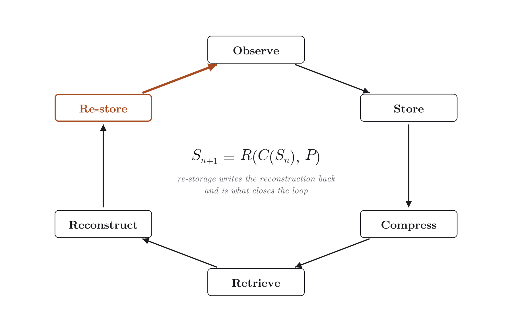

# **Restorage Drift: A Theory of Information State Evolution Under Repeated Compression and Reconstruction**

**J.B.T. Beebe**¹

¹ Independent Researcher

**Corresponding author:** jbbeebe@student.fullsail.edu  ·  **ORCID:** 0009-0009-2394-9714

**Version 1.0.0 — 27 November 2026.** Preprint; not peer reviewed. Companion test protocol: Supplementary Material S1.

## **Abstract**

Human recollection is reconstructive rather than archival, but the reconstruction literature mostly describes single retrieval episodes. This paper proposes Restorage Drift, which treats repeated compression, reconstruction, and re-storage as a state-evolution process. The Mandela Effect, a class of shared and consistent false memories, motivates the framework without bounding it. Under resource constraints a system compresses its stored state, reconstructs from the compressed trace using prior structure, and writes the result back as the state the next cycle operates on. Because re-storage closes the loop, the reconstruction error is never compared against the record; it becomes the record. The framework separates three things that are easily conflated: the candidate representations a system can still entertain, the evidence surviving for each of them, and the reconstructed probability each receives. Two compression pathways are modelled apart, irreversible removal of candidates and decay of evidence below an availability threshold, and only the third operation is reconstruction. Under stated conditions the active candidate set is nested and eventually stabilizes; once it does, the reconstructed distribution converges to a power-weighted prior restricted to the survivors. The paper distinguishes gradual probability drift, direct representational loss, and delayed evidence-mediated loss: different trajectories to a prior-dominated terminus that differs in which candidates survive, and which a terminal measurement alone need not distinguish. It states which results follow from the model and which remain hypotheses about resource constraints. It relates the framework to reconstructive memory, reconsolidation, iterated learning, cultural attraction, information bottleneck models, and model collapse, states falsifiable predictions, and specifies, in iterative summarization, a test protocol prepared for pre-registration.

**Keywords:** reconstructive memory; cultural transmission; iterated learning; model collapse; semantic drift; attractors; lossy compression; iterative summarization

## **1\. Introduction & Core Objects**

Human recollection is not a passive archival playback of past events; rather, it is an active, reconstructive process shaped by prior knowledge, context, and cognitive schemas (Bartlett, 1932). While existing traditions in reconstructive memory and schema theory explain why individual recalls deviate from exact records, they less frequently examine how repeated cycles of storage, compression, recall, reconstruction, and re-storage alter an information state over time.

**Restorage Drift** proposes that when an information-processing system operates under resource constraints and repeatedly compresses, reconstructs, and re-stores states across cycles, small discrepancies can accumulate into structured, non-random shifts. The Mandela Effect serves in this paper as a motivating example and observable manifestation of this broader state-evolution dynamic, rather than the sole boundary of the theory (Broome, 2009; Prasad & Bainbridge, 2022).

We refer to the phenomenon described here as restorage drift: the cumulative divergence produced when reconstructed information is re-stored and becomes the input to future compression-reconstruction cycles. The term is coined from the re-storage requirement of Section 2: drift compounds only because reconstructed output is written back as the state the next cycle operates on. Compression and reconstruction alone are shared with much adjacent work; re-storage is what closes the loop, and naming the phenomenon after it keeps that mechanism in view.

```{=latex}
\needspace{6\baselineskip}
```

To anchor the framework clearly from the outset, the theory defines the stored state, the representations available to it, the evidence surviving for each, and the operations that act on them:

* $S$ **(Stored State):** The active representation of information held by the system at a given stage, denoted $S_n$ at cycle $n$.
* $K$ **(Candidate Space):** The candidates the system can still represent, after any direct removal, denoted $K_n$ at cycle $n$.
* $E$ **(Evidence State):** The surviving evidence supporting each candidate, denoted $E_n(x)$ for candidate $x$ at cycle $n$. A candidate below an availability threshold is unavailable for reconstruction whether or not it remains representable.
* $C$ **(Compression Operator):** The transformation that reduces state detail, specificity, or dimensionality under resource limits, producing a compressed representation $C(S_n)$.
* $R$ **(Reconstruction Operator):** The generative process that rebuilds a usable state from compressed information, conditioned on available context and priors.
* $P$ **(Prior Distribution / Semantic Context):** Existing expectations, cultural patterns, linguistic norms, schemas, and contextual cues that shape how missing or compressed detail is filled in during reconstruction.
* $T_d$ **(Semantic Drift Threshold):** The cycle at which the original state no longer retains a majority of the reconstructed mass. It is a majority-loss convention on a probability distribution, not a decomposition of how much of the reconstruction the prior supplied; crossing it changes the direction of subsequent cycles rather than introducing a minor, easily reversed slip. Section 5.6 separates it from the cycle at which the original becomes unavailable altogether.
* $A$ **(Attractor):** The limiting distribution to which reconstruction converges once the active support has stabilized (Proposition 3), located by the prior restricted to the surviving candidates. An attractor here is a distribution over candidates rather than a single state, and it holds only for as long as the support that defines it does.

## **2\. The Operational Cycle & Resource Constraint Principle**

In restorage drift, information does not merely sit dormant between retrieval events. Instead, states move through a recurring operational loop under bounded capacity:

Each pass through this cycle can be understood through five functional stages:

1. **Observation:** The system encounters an initial signal, event, or representation and forms an early encoding.
2. **Compression:** Because retaining full fidelity across time and competing demands is costly, the system strips or compacts elements of the stored representation ($C$).
3. **Retrieval:** When the information is needed again, the system accesses the compressed or degraded trace rather than an untouched master copy.
4. **Reconstruction:** Because the compressed trace is underdetermined, the system rebuilds a coherent representation ($R$) drawing on remaining cues and prior structure ($P$).
5. **Re-storage:** Crucially, the reconstructed output is written back as the new stored state ($S_{n+1}$), becoming the baseline input for future cycles rather than leaving the prior state untouched.

{width=90%}

Formally, the framework summarizes this recursive state-update relationship across cycles as:

$$S_{n+1} = R\big(C(S_n),\, P\big)$$

where $S_n$ is the stored state at cycle $n$, $C(S_n)$ is its compressed form, $P$ represents prior structure and contextual constraints influencing reconstruction, and $S_{n+1}$ is the resulting re-stored state entering cycle $n+1$.

This equation is a compact summary of the operational mechanism rather than a claim of physical law. Its power lies in the **re-storage requirement**: if a system reconstructs a memory or representation transiently without overwriting its stored state for future cycles, errors remain episodic. Once $S_{n+1}$ replaces or updates the active stored state, compression errors and prior-driven reconstructions compound across iterations.

**Resource Constraint Principle**

When accumulated state complexity exceeds available preservation capacity, systems increasingly rely upon compression and reconstruction rather than perfect retention.

In practical terms, when accumulated state complexity outpaces available memory, attention, bandwidth, or compute budgets, systems turn to lossy compression paired with prior-informed or inferential reconstruction. Over time, repeated application of the recursion $S_{n+1} = R(C(S_n),\, P)$ governs whether a state remains anchored to its origin or crosses into a new regime.

## **3\. Worked Examples & Mode-Dependent Drift Pathways**

A central claim of restorage drift is that different forms of compression do not produce identical drift behavior. Rather than assuming a single uniform drift rate or a single universal threshold across all information types, the framework treats the drift threshold as mode-sensitive: what is stripped, how much disambiguating detail is lost, what prior structure ($P$) is available, and how reconstruction ($R$) operates all shape how a state moves across cycles.

The three cases below are widely circulated examples of shared misremembering, not results of controlled studies. Population-level evidence for consistent shared false memory exists, but so far chiefly for visual icons (Prasad & Bainbridge, 2022); prior-driven substitution of the same kind is well established in the laboratory (Roediger & McDermott, 1995). For the verbal and orthographic cases the available record is popular documentation, and the analyses below should be read as illustrations of a mechanism rather than as evidence for it.

| Example | Compression Mode | What Is Stripped / Compressed | Dominant Prior / Cue ($P$) | Resulting Drift & Attractor (A) |
| :---- | :---- | :---- | :---- | :---- |
| *Looney Tunes* $\to$ *Looney Toons* | Qualifier & schema compression | Musical / orchestral framing | Broad cartoon category \+ phonetic similarity | Shifts from *"Tunes"* to *"Toons"* once musical cue weakens |
| *Berenstain Bears* $\to$ *Berenstein Bears* | Orthographic compression | Exact low-frequency spelling (-stain) | High-frequency surname/cultural prior (-stein) | Spelling shifts to \-stein while series concept persists |
| *"No, I am your father"* $\to$ *"Luke, I am your father"* | Contextual & cue compression | Surrounding scene dialogue / "No." anchor | Standalone quote demand \+ addressee cue ("Luke") | Adds "Luke," to make quote self-contained outside scene |

### **Example 1: *Looney Tunes* $\to$ *Looney Toons* (Qualifier & Schema Compression)**

* **Initial State & Compression ($C$):** An animated series centered on musical and orchestral themes ("tunes") is encountered alongside broad cartoon conventions. Over time, specific qualifier detail ("musical") is compressed away in favor of a generalized cartoon schema.
* **Reconstruction & Prior Influence ($P$):** When reconstructing the title from a compressed representation, the strong category prior of "cartoons" interacts with phonetic similarity ("tunes" / "toons").
* **Re-storage & Threshold Crossing ($T_d$):** As the musical-qualifier anchor weakens across repeated recalls and retellings, the title's reconstruction stops being majority-anchored to the record and becomes majority prior-supplied. Once *"Looney Toons"* is re-stored and reinforced as the dominant form, it acts as a stable attractor ($A$) for subsequent recall; the Toons variant circulates widely enough to be catalogued as a recurring shared misremembering (Broome, 2009).

```{=latex}
\needspace{10\baselineskip}
```

### **State Evolution Walkthrough: *Looney Tunes* $\to$ *Looney Toons***

Looney Tunes is a musical cartoon short  
  $\to$ Looney Tunes is a musical cartoon  
  $\to$ Looney Tunes \= musical cartoon  
  $\to$ Looney Musical Cartoons  
  $\to$ Looney \[Car\]toons  
  $\to$ Looney Cartoons  
  $\to$ Looney Toons

### **Example 2: *Berenstain Bears* $\to$ *Berenstein Bears* (Orthographic Compression Under Prior Bias)**

* **Initial State & Compression ($C$):** The surname *Berenstain* contains a low-frequency orthographic ending (-stain) inside a familiar children's book schema. Under routine reading and memory compression, exact letter-level detail is compressed more aggressively than high-level narrative or character identity.
* **Reconstruction & Prior Influence ($P$):** During recall without direct visual inspection, orthographic reconstruction leans on high-frequency English and cultural surname priors (-stein). Rendered at the level of letters, this is the same prior-driven substitution that laboratory paradigms produce at the level of meaning, where associative structure reliably yields confident endorsement of material never presented (Roediger & McDermott, 1995).
* **Re-storage & Threshold Crossing ($T_d$):** When \-stein is repeatedly reconstructed and re-stored, the drift threshold is crossed at the orthographic level even while the broader series identity remains intact—illustrating how localized character-level compression can shift spelling without erasing the surrounding concept.

```{=latex}
\needspace{10\baselineskip}
```

### **State Evolution Walkthrough: *Berenstain Bears* $\to$ *Berenstein Bears***

Series schema \+ "-stain" spelling  
  $\to$ Exact letter detail compressed  ($C$)
  
  $\to$ High-frequency "-stein" prior applied  ($P$)
  
  $\to$ Crosses $T_d$ at orthographic level while concept holds  
  $\to$ Re-stored with "-stein" $\to$ Stabilizes as Attractor ($A$)

### **Example 3: *"No, I am your father"* $\to$ *"Luke, I am your father"* (Contextual & Cue Compression)**

* **Initial State & Compression ($C$):** In its original scene context, the line functions as a direct rebuttal ("No. I am your father.") anchored to preceding dialogue. When lifted out of the scene for standalone quotation, surrounding conversational context is compressed away.
* **Reconstruction & Prior Influence ($P$):** Stripped of immediate scene context, a standalone quote lacks an explicit addressee or setup. Verbatim form is retained only briefly even for material just heard, while gist persists, so a line recalled years later is regenerated rather than replayed (Sachs, 1967). Reconstruction draws on cultural and narrative priors to supply an identifying cue ("Luke").
* **Re-storage & Threshold Crossing ($T_d$):** Once "Luke, I am your father" is repeatedly recalled, quoted, and re-stored as a self-contained line, contextual compression pushes the state past its threshold into a new stabilized phrasing.

```{=latex}
\needspace{10\baselineskip}
```

### **State Evolution Walkthrough: *"No, I am your father"* $\to$ *"Luke, I am your father"***

Scene dialogue ("No. I am your father.")  
  $\to$ Scene context / "No." anchor compressed  ($C$)
  
  $\to$ Standalone quote prior supplies "Luke" cue  ($P$)
  
  $\to$ Crosses $T_d$ when quote detaches from scene  
  $\to$ Re-stored as "Luke, I am your father" $\to$ Stabilizes as Attractor ($A$)

```{=latex}
\vspace{9pt}
```

Taken together, these three examples show that qualifier/schema compression, orthographic compression, and contextual compression can each trigger drift through distinct pathways and threshold moments, rather than forcing every case through a single identical failure mode.

## **4\. Relationship to Existing Models**

Restorage drift builds upon several established traditions in cognitive science, memory research, information theory, and probabilistic modeling while differing from each in scope and emphasis. Rather than competing with or replacing these approaches, the framework provides an organizational lens focused on cumulative state evolution under repeated compression, reconstruction, and re-storage.

* **Reconstructive Memory:** The framework agrees with classical reconstructive-memory accounts that recollection is constructive rather than a verbatim replay of a fixed record (Bartlett, 1932). However, traditional reconstructive-memory work often centers on single retrieval episodes or immediate recall distortion, whereas restorage drift emphasizes cumulative state evolution across repeated cycles of compression, reconstruction, and re-storage ($S_{n+1} = R(C(S_n),\, P)$).
* **Semantic Compression of Memory:** Nagy, Török, and Orbán (2020) show that compressing episodic experience through a generative model produces *systematic* rather than random distortions, and that the resulting distortion profile reproduces a range of experimental memory phenomena. This is the nearest neighbour to restorage drift in the existing literature, and the two differ in what they model rather than in what they assume: their account compresses an episode once into a semantic schema, whereas restorage drift concerns what happens when that compressed output is re-stored and compressed again, and with the threshold and attractor structure repetition produces. The accounts are complementary—their distortion profile is a natural candidate for the per-cycle error this framework's recursion accumulates.
* **Memory Reconsolidation:** Restorage drift is compatible with memory reconsolidation research showing that retrieving a memory can place it in a labile state before it is restabilized (Nader et al., 2000). Where reconsolidation focuses on neurobiological and retrieval-induced restabilization mechanisms, restorage drift operates at a functional state-evolution level and introduces semantic drift thresholds ($T_d$), attractor states ($A$), and mode-dependent drift pathways across iterative cycles.
* **Iterated Learning:** Restorage drift shares with iterated learning models an interest in how information transforms across repeated transmissions and converges toward structured or prior-favored forms (Smith et al., 2003; Kirby et al., 2014). The convergence of iterated Bayesian transmission on the learners' prior is established there (Griffiths & Kalish, 2007), as is the amplification of prior differences under deterministic selection, with the data bottleneck rather than the strength of the prior setting how far the resulting distribution departs from unbiased copying (Kirby, Dowman, & Griffiths, 2007). Three differences remain, and they are what restorage drift adds. The state space here is not given in advance but narrowed along the trajectory, so the limit is the prior restricted to the surviving support, and the outcomes that narrowing separates follow from that (Section 5.6). The quantities of interest are transient—the cycles at which availability, then majority, then plurality are lost—rather than the asymptotic stationary distribution alone. And the loop closes inside a single system that reads and rewrites its own state, with no learner–teacher boundary for a sampling step to cross. Beyond that, the framework extends past interpersonal or generational transmission chains to propose analogous compression-reconstruction dynamics across individual memory systems, organizations, cultural artifacts, and artificial information-processing systems.
* **Cultural Attraction:** Restorage drift's attractor state ($A$) aligns with cultural attraction theory, which holds that cultural items are not copied with random noise but reconstructed toward attractors set by cognitive and ecological factors, so that certain variants recur predictably across transmission (Sperber, 1996; Claidière & Sperber, 2007). The framework shares that emphasis on reconstruction toward preferred forms but differs in two respects: it locates the cause of attraction in compression under capacity rather than in content-specific factors of attraction, and it predicts a threshold ($T_d$) at which a lineage's dependence on its original state gives way to dependence on the prior.
* **Information Bottleneck Frameworks:** Restorage drift's resource-constraint assumptions align with information bottleneck approaches that study trade-offs between compact representations and preserved task-relevant information under capacity limits (Tishby et al., 2000). The framework differs in focusing on the long-term trajectory of repeated compression-reconstruction-restoration cycles—including threshold crossings and attractor stabilization—rather than single-pass optimal encoding alone.
* **Model Collapse in Iterative Generation:** Recent work shows that generative models trained recursively on their own outputs degrade—losing distributional tails and concentrating on high-probability regions of the original data (Shumailov et al., 2024). This is the clearest artificial instance of the mechanism restorage drift describes: each generation is compressed relative to its predecessor and reconstructed from the model's prior. The correspondence with iterated learning has since been made explicit: self-training instantiates it, and repeated training amplifies the model's prior (Ren et al., 2024), a prediction Guo et al. (2026) test over ten generations of fine-tuning and confirm, along with the non-monotonic compositionality trajectory that compression without communicative pressure predicts, and the result closest to this framework—an uninformed filter leaves degradation intact where a quality-grounded one sustains structure, which is the compression–communication tradeoff (Kirby et al., 2015). Two things separate restorage drift from that account. There the loop runs through the data, each generation a fresh fine-tune from a frozen base model, so the hypothesis space is fixed in advance by that model's prior; here the retained set is produced by the trajectory, and two systems matched on prior reach different attractors if their compressions removed different candidates (Section 5.5). And their loop carries a learning step at every cycle, whereas the claim here is that the same structure appears where re-storage alone closes it, in a single system that reads and rewrites its own state with no learner–teacher boundary.
* **Bayesian and Predictive Frameworks:** Restorage drift's inclusion of a prior term ($P$) reflects the broad insight that inference and reconstruction are shaped by prior knowledge and contextual expectations (Clark, 2013). However, the framework focuses specifically on how repeated cycles of lossy compression and prior-informed re-storage alter state trajectories over time, potentially generating threshold transitions and attractor convergence rather than treating inference primarily as optimal belief updating over static hypotheses.

## **5\. A Unified Formal Model**

This section exhibits one explicit instantiation of the framework. It is deliberately minimal, and it is offered as a representative member of the class of compression–reconstruction systems restorage drift addresses, not as a claim that any biological, cultural, or artificial system compresses by these rules. The general framework asserts only that some $C$ and some $R$ operate under the Resource Constraint Principle; which functions they are in any given system is an empirical question.

The instantiation separates three things the framework would otherwise risk conflating: which candidates a system can still represent, how much evidence survives for each of them, and how much reconstructed probability each receives. In practice two of these may move together, but they are separate mechanisms with separate observable consequences, and only the last of them is reconstruction.

### **5.1 State Variables**

Let $X$ be a finite universe of candidate representations: the candidate spellings of a name, say, or the candidate phrasings of a quotation. At cycle $n$, let

$$K_n \subseteq X$$

be the candidate space not yet directly removed from the system's representational inventory. Let $E_n(x) \geq 0$ denote the surviving evidence associated with candidate $x$, and let $\varepsilon > 0$ be an availability threshold. The active candidate set is

$$A_n = \{\, x \in K_n : E_n(x) > \varepsilon \,\}.$$

The reconstructed state $S_n$ is a probability distribution over $A_n$, and the prior $P(x)$ assigns positive weight to candidates for which reconstruction is defined.

This allows three different events to be told apart. A candidate may remain in $A_n$ while its reconstructed probability declines. A candidate may be removed from $K_n$ directly, whether or not its probability had been falling. Or a candidate may remain in $K_n$ while its evidence falls below $\varepsilon$, which removes it from $A_n$ without any prior change in its stored probability.

### **5.2 Direct Representational Restriction**

Let $D_n \subseteq K_n$ be the candidates directly removed during cycle $n$, and define

$$K_{n+1} = K_n \setminus D_n.$$

The model assumes direct removal is irreversible: a candidate removed from $K_n$ is not automatically reintroduced at a later cycle.

The mechanism determining $D_n$ is not specified universally. In an empirical application it could depend on a compression algorithm, a storage constraint, or a selection rule. The set $D_n$ must be specified or measured; it cannot be inferred from a candidate's failure to appear in a finite sample of outputs.

### **5.3 Evidence Degradation**

For candidates retained in $K_{n+1}$, let evidence evolve as

$$E_{n+1}(x) = \rho_x(W)\, E_n(x), \qquad 0 < \rho_x(W) \leq 1,$$

where $W$ is a resource budget and $\rho_x(W)$ a candidate-specific retention factor. A value near one represents high retention; a lower value represents faster degradation. This multiplicative law is a modelling assumption chosen for tractability, not a finding about any particular system.

The active set is recalculated as $A_{n+1} = \{\, x \in K_{n+1} : E_{n+1}(x) > \varepsilon \,\}$. If a candidate is not directly removed and has constant $0 < \rho_x(W) < 1$, its first evidence-threshold crossing is

$$n_x = \left\lceil \frac{\log\left(\varepsilon / E_0(x)\right)}{\log \rho_x(W)} \right\rceil,$$

provided $E_0(x) > \varepsilon > 0$. This is the first integer cycle at which $E_n(x) \leq \varepsilon$ under the stated geometric-decay assumption, and it does not establish that evidence in any empirical system decays geometrically.

### **5.4 Reconstruction and Re-storage**

For a nonempty active set, define

$$S_{n+1}(x) = \frac{\mathbf{1}[x \in A_{n+1}]\, S_n(x)^{\alpha} P(x)^{\beta}}{\displaystyle\sum_{y \in A_{n+1}} S_n(y)^{\alpha} P(y)^{\beta}}, \qquad \alpha, \beta > 0.$$

For this to be well-defined, the initial state and prior must be positive on candidates that remain active. Because active sets are nested under the assumptions below, no new candidate enters the support through this update. If the active set becomes empty the rule is undefined, and an application must specify whether the system terminates, abstains, or invokes a separately modelled generation process.

The reconstructed distribution is re-stored and becomes the state used in the next cycle. The absorbing-support assumption is explicit: this model does not allow reconstruction to generate a candidate that is no longer active. Candidate regeneration is a possible extension, but it is a distinct mechanism and not a recovered one.

### **5.5 Mathematical Consequences**

**Proposition 1 (Nested active support).** If direct removal is irreversible, $0 < \rho_x(W) \leq 1$, and $\varepsilon$ is fixed, then $A_{n+1} \subseteq A_n$.

*Proof.* By definition $K_{n+1} \subseteq K_n$. For every candidate retained in $K_{n+1}$, $E_{n+1}(x) = \rho_x(W) E_n(x) \leq E_n(x)$. Any candidate in $A_{n+1}$ was therefore in $K_n$ and had $E_n(x) > \varepsilon$, so it was in $A_n$. $\square$

**Proposition 2 (Finite support stabilization).** If $X$ is finite and the active sets are nested, there exists a finite $N$ and a set $A_\infty$ such that $A_n = A_\infty$ for all $n \geq N$.

*Proof.* A finite set admits only finitely many strict reductions, and nested subsets of a finite set can reduce only finitely many times. $\square$

Proposition 2 does not imply that the stabilized set is nonempty, nor that every candidate eventually disappears. Both depend on the removal and retention parameters.

**Proposition 3 (Convergence after support stabilization).** Suppose that $A_n = A_\infty \neq \varnothing$ for all $n \geq N$; that $S_N(x) > 0$ and $P(x) > 0$ for every $x \in A_\infty$; and that $0 < \alpha < 1$, $\beta > 0$. Then for $x \in A_\infty$,

$$S_n(x) \;\propto\; S_N(x)^{\alpha^{\,n-N}}\, P(x)^{\beta\left(1 + \alpha + \cdots + \alpha^{\,n-N-1}\right)},$$

and

$$\lim_{n \to \infty} S_n(x) = \frac{P(x)^{\beta / (1-\alpha)}}{\displaystyle\sum_{y \in A_\infty} P(y)^{\beta / (1-\alpha)}},$$

with limiting mass zero for $x \notin A_\infty$.

*Proof.* Once the active set is fixed the update is $S_{n+1}(x) \propto S_n(x)^{\alpha} P(x)^{\beta}$ on that set, and iterating gives the finite-cycle expression. Since $0 < \alpha < 1$, the exponent $\alpha^{\,n-N} \to 0$ while the geometric sum converges to $1/(1-\alpha)$; normalizing the limiting weights gives the stated distribution. $\square$

The proposition is conditional on eventual stabilization and positivity. It does not establish that any empirical system has those properties.

Proposition 3 is where the attractor construct earns its place. Once the active set stops changing, the recursion has a single attracting distribution on that set, and its location is fixed by the prior and the exponent $\beta/(1-\alpha)$ rather than by where the chain began. That the starting state disappears from the limit is a property of any contraction toward a fixed point, and it is not a result of this paper: Griffiths and Kalish (2007) establish the corresponding result for iterated Bayesian learning, in which transmission converges to a distribution determined entirely by the prior, regardless of the initial distribution and regardless of how much data each learner receives. The recursion above is a tempered member of that family, with $\beta/(1-\alpha)$ acting as a temperature on the prior and $\alpha$ fixing how many cycles of evidence the system effectively retains, $1/(1-\alpha)$. What this paper adds is not the convergence but the support over which it is taken: the limit runs over whatever survived, so two systems matched on prior, $\alpha$ and $\beta$ reach different attractors if their compressions removed different candidates.

### **5.6 Three Distinguishable Drift Outcomes**

The instantiation separates three outcomes that a single measure would confound:

1. **Gradual reconstructional drift:** $S_n(x^{*})$ changes across cycles while $x^{*} \in A_n$.
2. **Direct representational loss:** $x^{*}$ is removed through $D_n$ and leaves the active set at that cycle.
3. **Delayed evidence-mediated loss:** $x^{*}$ remains in $K_n$ but becomes unavailable when $E_n(x^{*}) \leq \varepsilon$.

These can occur in combination. A candidate can lose probability before it becomes unavailable, and direct removal can occur with no preceding decline in reconstructed probability. The binary classification of gradual versus instant drift used in earlier formulations is therefore not exhaustive, and the third pathway is the one that requires evidence to be modelled separately from probability.

Three landmarks follow, and they answer different questions:

$$T_A = \min\{\, n : x^{*} \notin A_n \,\}, \qquad T_d = \min\left\{\, n : S_n(x^{*}) < \tfrac{1}{2} \,\right\},$$

$$T_o = \min\{\, n : \exists\, y \neq x^{*},\; S_n(y) > S_n(x^{*}) \,\}.$$

$T_A$ measures loss of availability, $T_d$ loss of majority probability, and $T_o$ the first point at which a rival holds greater individual probability, with $T_A = \infty$ or $T_d = \infty$ where the event is not observed within the horizon. For a normalized distribution, $T_d \leq T_o$ wherever both are defined: while the original holds at least half the mass, no individual rival can exceed it.

![Retained mass of the original candidate under two reconstruction settings, with the support held fixed at four candidates. Candidate restriction is inactive here, so the figure isolates prior-weighted reweighting: it illustrates Proposition 3 and the separation of $T_d$ from $T_o$, not dynamic candidate loss. The upper curve crosses the one-half threshold at cycle 4 but keeps the lead until cycle 5, so $T_d = 4$ and $T_o = 5$; the lower curve crosses both at cycle 2 and ends in complete prior capture. The budget labels $W = 15$ and $W = 60$ name the two reconstruction settings and are illustrative parameter values: the mapping from a resource budget to $\beta$ is a hypothesis (Section 5.7), not a derived law. Simulated with $P = (0.10, 0.35, 0.35, 0.20)$, $S_0 = (0.94, 0.02, 0.02, 0.02)$, $\alpha = 0.8$, $k = 4$, and $\beta = 1.5$ ($W = 15$) versus $\beta = 0.3$ ($W = 60$).](figures/fig2-drift.png){width=90%}

A majority-loss event is not evidence that the prior causally supplied more than half of the reconstructed content. It is a probability-threshold convention, and separating $T_A$ from $T_d$ is what allows a study to tell representational loss from reweighting.

### **5.7 Resource Budget: Hypotheses, Not Theorem**

The resource budget may affect several parts of the model at once:

$$\rho_x = \rho_x(W), \qquad D_n = D_n(W, \ldots), \qquad \alpha = \alpha(W), \qquad \beta = \beta(W).$$

These are distinct empirical relationships. Lower $W$ might reduce evidence retention, increase direct candidate removal, alter the relative influence of the prior, or produce some combination of the three. The framework does not derive the sign or functional form of any of them.

Accordingly, the claim that lower resource budgets necessarily increase prior influence has to stand as a hypothesis rather than as a mathematical consequence, and no conclusion about the limit $W \to 0$ follows without specifying and justifying the relevant functions of $W$.

### **5.8 Relation to Fixed-$k$ Truncation**

An earlier illustrative recurrence used

$$C(S_n)(x) \;\propto\; S_n(x)\, \mathbf{1}\!\left[x \in \operatorname{Top}_k(S_n)\right].$$

With fixed $k$, positive retained weights and positive prior weights, this operation does not by itself produce delayed candidate elimination. If the initial support holds more than $k$ candidates, the first compression selects $K = \operatorname{Top}_k(S_0)$; reconstruction preserves positive mass on every member of $K$, so each later truncation returns the same set. If the initial support holds at most $k$ candidates, the first compression removes none.

Fixed-$k$ truncation therefore performs an initial support selection, not a trajectory-dependent sequence of delayed reductions. It can illustrate prior-weighted reallocation within a fixed support, but it cannot support a claim that candidates may be dropped at arbitrary later cycles. The instantiation above introduces separate mechanisms for direct removal and evidence-mediated loss rather than attributing those outcomes to the truncation operator.

### **5.9 Scope and Extensions**

The model assumes irreversible loss from the active set. If a generative system can produce candidates not present in its stored state, a candidate-generation operator must be added, and its distribution, conditioning information and interaction with the prior require separate specification. Candidate generation is not evidence that an absorbing-support model has recovered a candidate it had eliminated.

The evidence variable also requires application-specific operationalization. It should not be treated as observed merely because a system emits a probability or a textual answer, and the mapping from an empirical measure to $E_n(x)$, and from response frequencies to $S_n(x)$, must be justified separately for each study.

The contribution of this instantiation is therefore a separation of mechanisms and a set of conditional consequences. It does not establish that any particular empirical system follows the proposed dynamics.

## **6\. Multi-Layer & Cross-System Hypotheses**

While restorage drift is illustrated through human memory and cultural examples such as the Mandela Effect, its core mechanism is formulated for resource-constrained information systems generally. The framework hypothesizes that analogous compression-reconstruction dynamics may emerge across multiple classes of information-processing systems, including biological cognition, cultural transmission, organizational memory, and artificial intelligence architectures.

In organizational or technical settings, for example, summaries of meetings, incident reports, or documentation frequently compress detailed operational states into shorter artifacts that later serve as inputs for future decisions and new summaries. Similarly, in artificial intelligence systems that repeatedly summarize, retrieve, or regenerate context under token or memory budgets, iterative compression and reconstruction can amplify subtle shifts over time.

Treating cross-layer alignment as a hypothesis rather than a settled conclusion keeps the framework disciplined: whether similar threshold and attractor patterns appear across biological, cultural, organizational, and artificial systems is an empirical question to be tested, not a foregone assumption.

## **7\. Predictions, Falsifiability & Open Research Questions**

For restorage drift to function as a rigorous scientific framework rather than a purely post-hoc explanation, it must generate clear predictions and identify conditions that would challenge or falsify it. Section 5 supplies one instantiation in which several of these predictions take a measurable form; the statements below are the framework-level versions, which are meant to hold whether or not that particular instantiation is the right model of any given system.

### **Core Predictions**

* **Non-Random Directional Drift:** Under resource constraints and active re-storage ($S_{n+1} = R(C(S_n),\, P)$), repeated compression-reconstruction cycles will produce directional shifts shaped by priors ($P$) and compression modes rather than purely uniform, aimless noise. Where the instantiation of Section 5.5 applies, the direction is not merely "toward the prior" in the loose sense but toward the prior raised to $\beta/(1-\alpha)$ and renormalized over the surviving set; as that exponent grows the limit concentrates on the surviving candidate of highest prior mass, or on the co-modal set where that maximum is tied.
* **Threshold Transitions ($T_d$):** As informative detail is compressed across cycles, systems will exhibit a transition point at which the original state stops retaining a majority of the reconstruction. In the instantiation this is $T_d$, the first cycle at which the original state's reconstructed mass falls below one half; where more than two candidates survive, outright overtaking—the secondary landmark $T_o$ of Section 5.6—follows later, and both are distinct from the cycle at which the original becomes unavailable, $T_A$.
* **Attractor Convergence ($A$):** Across repeated cycles or multiple observers/instances sharing similar priors, drifted states will tend to converge toward recurring attractor configurations. Proposition 3 makes this specific rather than generic, but only in part, and only where the active set has stabilized and remains non-empty: that the limit is fixed by the prior rather than the starting state is the iterated-learning result of Griffiths and Kalish (2007), and the framework's own claim is the restriction of that limit to a retained set determined by the compression history. Where the prior's modes are tied, the attractor is co-modal and the prediction concerns that modal set rather than a single state.
* **Mode Sensitivity:** Distinct compression modes (such as qualifier/schema compression, orthographic compression, and context removal) will produce different drift trajectories and threshold locations—in the instantiation, different retained sets and different effective balances of $\alpha$ and $\beta$, and therefore different $T_d$.

```{=latex}
\needspace{7\baselineskip}
```

### **Falsifiability Conditions**

The framework's core claims would be undermined or falsified if controlled investigations consistently found that:

1. Repeated compression-reconstruction-restoration cycles produce **no measurable drift** even under strict resource constraints and high iteration counts where original cues are degraded.
2. Observed changes across cycles are **strictly random or white-noise divergence** with no systematic relationship to priors ($P$) or attractor states ($A$), even when strong priors are present.
3. Independent runs or observers under shared priors show **no convergence** toward attractors and **no threshold behavior** across varying compression modes.
4. Chains that share a prior ($P$) but begin from different original states converge to **different** attractors, or converge to attractors the prior does not predict. Proposition 3 excludes the first possibility only where the chains share a retained set, $0 < \alpha < 1$, and the support has stabilized. Where surviving sets differ, different limits are the model's prediction rather than a failure of it, and a comparison of terminal distributions across such chains that does not measure availability is uninformative. The second possibility remains a genuine falsifier: if attractor identity tracks where a chain started rather than which prior it ran under, the recursion is the wrong model of that system even though drift is plainly present.

5. A system claimed to instantiate the model reconstructs candidates that were demonstrably unavailable, with no separately specified generation mechanism. The absorbing-support assumption of Section 5.4 forbids this, and reappearance is evidence for candidate generation or for measurement failure rather than for recovery.

```{=latex}
\needspace{7\baselineskip}
```

### **Open Research Questions**

* Which empirical measurements of $T_d$ agree with the operational definition given in Section 5.6, and where do they diverge? The instantiation fixes the threshold as a proportion of reconstructed mass; recall tasks, transmission chains, and summarization loops may each need a different observable proxy, and disagreement between proxies is itself evidence about which construct is being measured. The same question applies to $T_A$, whose proxy will have to be a probe procedure rather than an observation of the latent set.
* Which properties of a prior distribution ($P$)—such as prior strength ($\beta$ in the instantiation), ambiguity, or familiarity—most strongly lower or raise the threshold for crossing into a new attractor state ($A$)?
* How do re-storage intervals, external reference checks, and explicit provenance markers delay or prevent crossing $T_d$ in human and artificial systems? Under the Section 5.4 recursion the answer is constrained in advance: a check that only observes the state cannot slow the drift, because drift accumulates through re-storage rather than through inspection. Only a check that restores the state—overwriting it with record-anchored content—can move $T_d$ outward. The filtering contrast of Guo et al. (2026) is the artificial form of that prediction: uninformed filtering is indistinguishable from no filter on any of their five metrics, while quality-grounded filtering sustains structure.
* Where do compression-reconstruction dynamics in biological memory, organizational workflows, and AI systems converge, and where do their mechanisms fundamentally diverge?

```{=latex}
\vspace{9pt}
```

These conditions can be tested in one system where the reconstruction half of Section 5 is measurable—iterative summarization—and a companion protocol sets out the items, arms, controls, predictions specified in advance, and analysis plan for doing so (Supplementary Material S1).

```{=latex}
\needspace{16\baselineskip}
```

## **Declarations**

**Funding.** None to declare.

**Conflicts of interest.** The author declares no competing interests.

**Data availability.** This article reports no empirical data. The companion protocol (Supplementary Material S1) specifies the data the proposed study would generate; materials, prompts, and analysis code will be deposited in a public repository upon execution.

**Author contributions (CRediT).** J.B.T. Beebe: Conceptualization, Methodology, Formal analysis, Writing – original draft, Writing – review & editing.

**Ethics.** Not applicable. No human participants or animals were involved.

```{=latex}
\begingroup\small\setlength{\parskip}{8pt}
```

## **References**

Bartlett, F. C. (1932). *Remembering: A Study in Experimental and Social Psychology*. Cambridge University Press.

Broome, F. (2009). *The Mandela Effect*. https://mandelaeffect.com

Claidière, N., & Sperber, D. (2007). The role of attraction in cultural evolution. *Journal of Cognition and Culture*, 7(1–2), 89–111.

Clark, A. (2013). Whatever next? Predictive brains, situated agents, and the future of cognitive science. *Behavioral and Brain Sciences*, 36(3), 181–204.

Griffiths, T. L., & Kalish, M. L. (2007). Language evolution by iterated learning with Bayesian agents. *Cognitive Science*, 31(3), 441–480.

Guo, D., Wu, J., & Yiu, S. M. (2026). Model collapse as cultural evolution. *Proceedings of the Conference on Computational Natural Language Learning (CoNLL 2026)*. arXiv:2605.23054

Kirby, S., Dowman, M., & Griffiths, T. L. (2007). Innateness and culture in the evolution of language. *Proceedings of the National Academy of Sciences*, 104(12), 5241–5245.

Kirby, S., Griffiths, T. L., & Smith, K. (2014). Iterated learning and the evolution of language. *Current Opinion in Neurobiology*, 28, 108–114.

Kirby, S., Tamariz, M., Cornish, H., & Smith, K. (2015). Compression and communication in the cultural evolution of linguistic structure. *Cognition*, 141, 87–102.

Nader, K., Schafe, G. E., & Le Doux, J. E. (2000). Fear memories require protein synthesis in the amygdala for reconsolidation after retrieval. *Nature*, 406(6797), 722–726.

Nagy, D. G., Török, B., & Orbán, G. (2020). Optimal forgetting: Semantic compression of episodic memories. *PLOS Computational Biology*, 16(10), e1008367.

Prasad, D., & Bainbridge, W. A. (2022). The visual Mandela Effect as evidence for shared and specific false memories across people. *Psychological Science*, 33(12), 1971–1988.

Ren, Y., Guo, S., Qiu, L., Wang, B., & Sutherland, D. J. (2024). Bias amplification in language model evolution: An iterated learning perspective. *Advances in Neural Information Processing Systems*, 37, 38629–38664.

Roediger, H. L., & McDermott, K. B. (1995). Creating false memories: Remembering words not presented in lists. *Journal of Experimental Psychology: Learning, Memory, and Cognition*, 21(4), 803–814.

Sachs, J. S. (1967). Recognition memory for syntactic and semantic aspects of connected discourse. *Perception & Psychophysics*, 2, 437–442.

Shumailov, I., Shumaylov, Z., Zhao, Y., Papernot, N., Anderson, R., & Gal, Y. (2024). AI models collapse when trained on recursively generated data. *Nature*, 631(8022), 755–759.

Smith, K., Kirby, S., & Brighton, H. (2003). Iterated learning: A framework for the emergence of language. *Artificial Life*, 9(4), 371–386.

Sperber, D. (1996). *Explaining Culture: A Naturalistic Approach*. Blackwell.

Tishby, N., Pereira, F. C., & Bialek, W. (2000). The information bottleneck method. *Proceedings of the 37th Annual Allerton Conference on Communication, Control, and Computing* (1999) / arXiv:physics/0004057.

```{=latex}
\endgroup
```

## **Supplementary Material**

**S1.** *Restorage Drift in Iterative Summarization: A Test Protocol.* Item construction and prior estimation, five arms including the verbatim and star-topology controls, conditions, measures for reconstructed probability, candidate availability and textual evidence support, nine predictions specified in advance, analysis plan, and cost envelope for the test described in Section 7 of this paper.
